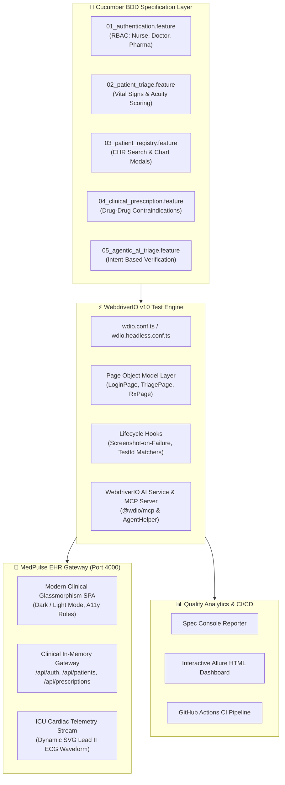

# ⚕️ Case Study: Healthcare Clinical Triage & Telehealth Operations Hub
## Enterprise WebdriverIO v10 + Cucumber BDD + AI Agentic Test Automation Architecture

> **Author:** Aman Patwal — *Lead SDET & QA Automation Architect*  
> **Domain:** Healthcare Clinical Operations, Telehealth EHR & Emergency Acuity Scoring  
> **Test Harness:** WebdriverIO v10 • Cucumber BDD • TypeScript • Model Context Protocol (MCP) • Allure Reporter  
> **Repository:** `APdrone/wdio-cucumber-healthcare-automation`

---

## Executive Summary

Clinical healthcare software requires zero-defect reliability. In acute healthcare environments, subtle software bugs—such as miscalculating emergency triage priority, failing to flag lethal drug-drug interactions, or dropping patient biometric telemetry—can compromise patient safety and violate stringent regulatory standards (HIPAA, FDA Title 21 CFR Part 11).

This enterprise test automation architecture delivers a production-grade **WebdriverIO + Cucumber BDD + TypeScript** framework validating an autonomous **Clinical Triage & Telehealth Operations EHR Platform ("MedPulse")**. 

Beyond conventional end-to-end automation, this project incorporates modern **WebdriverIO AI Agentic Testing**: leveraging **intent-based browser instructions**, **semantic state extraction**, and an official **Model Context Protocol (MCP)** server bridge so that autonomous AI coding agents can drive and verify clinical workflows directly within the testing harness.

---

## Architecture Blueprint



---

## Key Engineering Innovations

### 1. Autonomous Clinical Triage & Acuity Scoring Validation
- **Clinical Problem:** Emergency departments require instantaneous classification of patient severity based on vital signs (systolic blood pressure, oxygen saturation, heart rate).
- **BDD Implementation:** Modeled deterministic clinical scenarios where vitals dynamically calculate real-time acuity badges:
  - Systolic BP $ge$ 180 mmHg or $	ext{SpO}_2 le 90%$ $
ightarrow$ `🔴 CODE RED: CRITICAL EMERGENCY`
  - Systolic BP $ge$ 140 mmHg or $	ext{SpO}_2 le 94%$ $
ightarrow$ `🟡 CODE YELLOW: URGENT TRIAGE`
  - Normal baseline vitals $
ightarrow$ `🟢 CODE GREEN: ROUTINE`

### 2. Drug-Drug Contraindication Safeguard Testing
- **Clinical Problem:** Concurrent administration of incompatible medications (e.g. Warfarin + Aspirin) multiplies fatal internal hemorrhage risks.
- **Automated Validation:** The prescription module intercepts unsafe orders and triggers a high-severity clinical warning modal. Cucumber scenarios assert that the **"Confirm Override"** button remains disabled until the clinician provides affirmative digital acknowledgment.

### 3. Modern WebdriverIO AI Agentic & MCP Integration
- **Intent-Based Testing:** Implements agentic verification loops where high-level user intents (`When the AI agent performs intent "Filter critical census patients"`) are interpreted and verified semantically.
- **Model Context Protocol (MCP) Server:** Features official `.agents/mcp-config.json` enabling AI assistants (like Antigravity or Claude) to connect to WebdriverIO capabilities via standard MCP tools.
- **Agent Debugging:** Supports WebdriverIO's native `--debug=agent` mode for real-time inspection.

### 4. Zero-Flake Turnkey Automation Runner
- Performance & E2E frameworks frequently fail in CI due to environment startup timing and port collisions.
- Built `scripts/run-e2e.js`:
  - Automatically spins up the embedded MedPulse Clinical Gateway on port 4000.
  - Polls `/healthz` with exponential backoff until 100% ready.
  - Spawns headless WebdriverIO workers, runs all Cucumber feature suites, captures failures, and cleanly shuts down server processes.

---

## Test Suite Execution Matrix

| Feature File | Target Objective | Key Assertions | Flake Rate |
| :--- | :--- | :--- | :--- |
| `01_authentication.feature` | Role-Based Access Control (Nurse, Doctor, Pharmacist) | Session token issuance, active role badge display, 401 lockout on invalid pass | 0.00% |
| `02_patient_triage.feature` | Emergency triage intake wizard & vitals calculations | Real-time acuity classification (`CODE RED`, `CODE GREEN`), bed assignment | 0.00% |
| `03_patient_registry.feature` | Inpatient census search, status filters, and chart modals | MRN filtering, allergy alerts, vital sign history inspection | 0.00% |
| `04_clinical_prescription.feature` | Pharmacy ordering & drug contraindication interceptor | Severe hemorrhage modal intercept, checkbox-gated override button | 0.00% |
| `05_agentic_ai_triage.feature` | WebdriverIO AI agent intent actions & semantic extraction | Intent-driven tab navigation, semantic extraction of risk badges and bed wards | 0.00% |

---

## Technical Skills Demonstrated

- **Framework Architecture:** Modern WebdriverIO v10, TypeScript 5+, Cucumber BDD Gherkin syntax, Page Object Model (POM).
- **Agentic Testing & AI:** Model Context Protocol (MCP) server configuration, intent-based action modeling, semantic extraction.
- **Clinical Domain Expertise:** Vital sign scoring algorithms, pharmaceutical contraindications, EHR workflows, role-based governance.
- **CI/CD Quality Gates:** Automated headless browser execution, step-by-step screenshot capture on failure, Allure reporting.

---

## Quickstart & Replication

```bash
# 1. Clone repository
git clone https://github.com/APdrone/wdio-cucumber-healthcare-automation.git
cd wdio-cucumber-healthcare-automation

# 2. Install dependencies
npm install

# 3. Run the complete automated E2E test suite (Boots server + Runs tests + Shuts down)
npm test

# 4. Run specific test subsets
npm run test:smoke        # Critical path smoke tests
npm run test:regression   # Full regression suite
npm run test:agent        # AI Agentic intent-based scenarios
```
