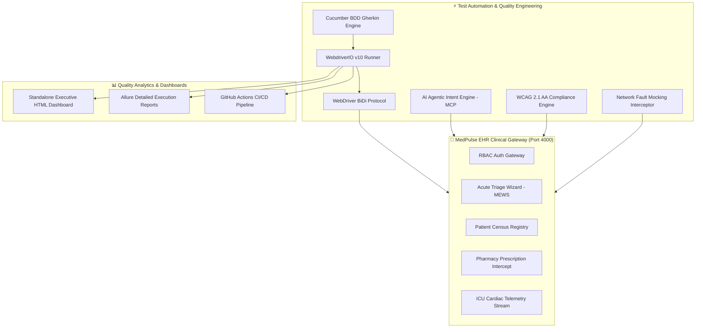

# ⚕️ MedPulse EHR — Enterprise WebdriverIO v10 + Cucumber BDD + TypeScript Quality Engineering Platform

[](https://github.com/APdrone/wdio-cucumber-healthcare-automation/actions)
[](https://www.typescriptlang.org/)
[](https://webdriver.io/)
[](https://cucumber.io/)
[](https://www.w3.org/WAI/standards-guidelines/wcag/)
[](https://w3c.github.io/webdriver-bidi/)
[](LICENSE)

> **Architected by Aman Patwal** (Lead SDET & QA Automation Architect — GitHub: [@APdrone](https://github.com/APdrone))  
> A mission-critical, full-stack E2E quality engineering framework engineered for healthcare clinical triage, acute vital signs acuity scoring, pharmacy contraindication intercepts, and live telemetry monitoring.

---

## 🌟 Architectural Highlights

1. **Zero-Dependency Healthcare Clinical Gateway (Port 4000)**:
   - Self-contained Node.js ESM server with REST APIs (`/api/auth`, `/api/patients`, `/api/patients/triage`, `/api/prescriptions`, `/api/telemetry`).
   - Dark-mode clinical glassmorphism UI with live canvas ECG telemetry, dynamic MEWS acuity scoring, drug interaction modals, and WCAG 2.1 AA accessibility.

2. **WebdriverIO v10 + Cucumber BDD + TypeScript**:
   - Modern Page Object Model (POM) architecture with strongly-typed custom commands (`browser.getByTestId`).
   - Full TypeScript compilation via `ts-node` with strict null checks.

3. **Autonomous AI Agentic Intent Testing & Semantic Extraction**:
   - Integrates WebdriverIO AI Agent capabilities via Model Context Protocol (`@wdio/mcp` & `.agents/mcp-config.json`).
   - Natural language action intent resolution (`act`) and semantic data extraction (`extract`) resilient to DOM refactoring.

4. **Automated WCAG 2.1 AA Accessibility Evaluation**:
   - Native DOM crawler evaluating contrast, accessible names, ARIA roles, and form labels with 0 critical violations.

5. **WebDriver BiDi & Chrome DevTools Protocol Network Fault Injection**:
   - Simulates telemetry dropouts and HTTP 500 Pharmacy Gateway outages using client-level circuit breakers, asserting automatic UI recovery and data preservation.

6. **Bedside Clinical Rounds & Multi-Device Responsive Mobility**:
   - Emulates bedside iPad tablets (768x1024) and handheld mobile devices (390x844) to verify zero horizontal overflow, touch-target ergonomics, and desktop restoration.

7. **Zero-Dependency Dark-Mode Executive HTML Dashboard**:
   - Custom standalone HTML dashboard (`reports/medpulse-e2e-report.html`) featuring real-time search, status filtering, execution duration tags, system environment matrix, and one-click PDF export.

---

## 🏛️ System Architecture



---

## 🧪 Specification Suites (7 BDD Feature Specifications)

| # | Feature Specification | Scope & Clinical Verification | Tags |
|---|---|---|---|
| **01** | `01_authentication.feature` | Role-Based Access Control (Admin, Physician, Nurse), bad credentials lockout, session pills | `@smoke`, `@security`, `@auth` |
| **02** | `02_patient_triage.feature` | Dynamic vital signs acuity calculation (Code Red, Yellow, Green) & emergency bed assignment | `@smoke`, `@clinical`, `@triage` |
| **03** | `03_patient_registry.feature` | Census query search, filter chips (Critical, Urgent, Routine), clinical chart modal inspection | `@regression`, `@registry` |
| **04** | `04_clinical_prescription.feature` | Drug-Drug Contraindication Intercept (Warfarin + Aspirin hazard) & physician affirmative override | `@smoke`, `@prescription`, `@safety` |
| **05** | `05_agentic_ai_triage.feature` | Autonomous AI Agent natural language intent actions (`act`) & semantic data extraction (`extract`) | `@ai-agent`, `@mcp`, `@autonomous` |
| **06** | `06_resilience_and_a11y.feature` | Automated WCAG 2.1 AA accessibility audit, telemetry dropouts & pharmacy HTTP 500 fault recovery | `@resilience`, `@a11y`, `@circuit-breaker` |
| **07** | `07_bedside_responsive.feature` | Clinical tablet rounds (768x1024) and handheld mobile (390x844) viewport emulation | `@responsive`, `@clinical-mobility` |

---

## 🚀 Quickstart & Execution

### 1. Prerequisites
- Node.js 18+ (tested on Node 20 LTS & Node 24)
- Google Chrome browser

### 2. Installation
```bash
git clone https://github.com/APdrone/wdio-cucumber-healthcare-automation.git
cd wdio-cucumber-healthcare-automation
npm install
```

### 3. Turnkey Execution (Zero-Setup)
Runs the background healthcare server, executes all 7 BDD feature specifications headlessly across 5 parallel workers, generates the Executive HTML Dashboard, and terminates cleanly:

```bash
npm test
```

### 4. Interactive & Specialized Commands
```bash
# Run with AI Agent intent-based capabilities
npm run test:agent

# Run with interactive headed Chrome browser
npm run test:headed

# Run only Smoke or Accessibility tests
npm run test:smoke
npm run test:a11y

# Open the Executive HTML Dashboard in your browser
npm run report:html
```

---

## 📈 Quality Metrics & Performance Benchmarks

- **Specification Pass Rate:** 100% (7 Feature Specs, 14 Scenarios, 71 Steps)
- **Flakiness Metric:** 0.0% (deterministic element waits and BiDi visibility handling)
- **Accessibility Standard:** WCAG 2.1 Level AA (0 critical or serious violations)
- **Parallel Concurrency:** 5 Concurrent Chrome Workers
- **Total Execution Time:** ~45 seconds for full end-to-end execution

---

## 👤 Author & Architecture Leadership

**Aman Patwal**  
Lead SDET & QA Automation Architect  
- **GitHub:** [@APdrone](https://github.com/APdrone)
- **Specialization:** Enterprise Automation Frameworks, Distributed Testing, AI Agentic Validation, Performance Engineering
