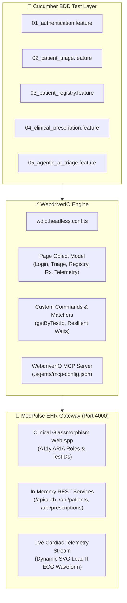

# ⚕️ Enterprise Healthcare Test Automation Framework
### Production-Grade WebdriverIO v10 + Cucumber BDD + TypeScript + AI Agentic Testing

[](https://webdriver.io/)
[](https://cucumber.io/)
[](https://www.typescriptlang.org/)
[](https://modelcontextprotocol.io/)
[](https://github.com/APdrone/wdio-cucumber-healthcare-automation)
[](https://opensource.org/licenses/MIT)

> Built by **[Aman Patwal](https://github.com/APdrone)** — *Lead SDET & QA Automation Architect*  
> Demonstrating enterprise test architecture for clinical healthcare software, emergency triage scoring, and pharmaceutical contraindication safeguards.

---

## 🎯 Overview

Healthcare clinical applications (Electronic Health Records, Clinical Decision Support, Telehealth) operate under strict regulatory and patient-safety requirements. This repository delivers an end-to-end **WebdriverIO + Cucumber BDD + TypeScript** automation framework engineered to validate:

1. **Role-Based Clinical Access Control (RBAC):** Distinct institutional roles for Triage Nurses, Attending Cardiologists, and Clinical Pharmacists.
2. **Emergency Triage Scoring Engine:** Real-time calculation of clinical acuity levels (`CODE RED: CRITICAL`, `CODE YELLOW: URGENT`, `CODE GREEN: ROUTINE`) based on multi-parameter vital signs.
3. **Pharmaceutical Contraindication Interceptor:** Automated modal interception of high-risk drug-drug interactions (e.g. Warfarin + Aspirin hemorrhage hazard) requiring affirmative clinician override.
4. **WebdriverIO AI Agentic Capabilities:** Official Model Context Protocol (MCP) server configuration, intent-based action modeling (`act`), and semantic state extraction.
5. **Zero-Flake Autonomous Lifecycle Runner:** Embedded clinical gateway running on port 4000 with automatic healthcheck polling and headless execution.

---

## 📐 System Architecture



---

## 📂 Repository Structure

```
wdio-cucumber-healthcare-automation/
├── .agents/
│   └── mcp-config.json                 # WebdriverIO MCP Server configuration
├── .github/
│   └── workflows/
│       └── wdio-e2e.yml                # GitHub Actions CI/CD Pipeline
├── app/                                # Standalone MedPulse Healthcare App
│   ├── public/                         # Modern Clinical Glassmorphism Frontend
│   │   ├── css/styles.css              # Dark/light mode theme & responsive styles
│   │   ├── js/app.js                   # Client state, triage score calculator, modals
│   │   └── index.html                  # Clinical Portal Single Page Application
│   └── server.js                       # Zero-dependency Node.js Gateway (Port 4000)
├── config/
│   ├── wdio.conf.ts                    # Base WebdriverIO configuration
│   ├── wdio.headless.conf.ts           # Headless browser configuration for CI
│   └── wdio.agent.conf.ts              # AI Agent testing configuration
├── features/                           # Cucumber BDD Feature Specifications
│   ├── 01_authentication.feature       # Role-Based Institutional Access Control
│   ├── 02_patient_triage.feature       # Patient Intake & Vital Signs Acuity Scoring
│   ├── 03_patient_registry.feature     # EHR Census Search, Filters, Chart Modals
│   ├── 04_clinical_prescription.feature# Rx Orders & Drug Contraindication Interceptor
│   ├── 05_agentic_ai_triage.feature    # AI Agent Intent-Based Actions & Verification
│   └── step-definitions/               # TypeScript Step Implementations
│       ├── auth.steps.ts
│       ├── triage.steps.ts
│       ├── registry.steps.ts
│       ├── prescription.steps.ts
│       └── agentic.steps.ts
├── src/
│   ├── pageobjects/                    # Page Object Model Layer
│   │   ├── Page.ts                     # Base Page with resilient wait helpers
│   │   ├── LoginPage.ts                # Auth form & persona selectors
│   │   ├── TriageWizardPage.ts         # Demographics, vitals & acuity badge POM
│   │   ├── PatientRegistryPage.ts      # Patient table, search & chart modal POM
│   │   ├── PrescriptionPage.ts         # Rx orders & drug interaction alert POM
│   │   └── TelemetryPage.ts            # ICU cardiac telemetry monitor POM
│   ├── support/
│   │   ├── custom-commands.ts          # Custom browser.getByTestId helpers
│   │   └── agent-helper.ts             # Intent-based AI action & extraction bridge
│   └── types/
│       └── clinical.types.ts           # Strongly typed clinical entities
├── scripts/
│   └── run-e2e.js                      # Turnkey autonomous orchestrator
├── package.json                        # Scripts & dependencies
├── tsconfig.json                       # TypeScript compiler options
├── PORTFOLIO_CASE_STUDY.md             # In-depth architectural case study
└── README.md                           # Documentation & quickstart guide
```

---

## 🚀 Quickstart

### 1. Run Complete Test Suite (Recommended)
This runs the autonomous orchestrator: boots the MedPulse Clinical Gateway on port 4000, awaits healthy status, executes the full headless WebdriverIO suite, and cleans up background processes.

```bash
npm test
```

### 2. Run Specific Test Tags

```bash
npm run test:smoke         # Fast critical-path smoke tests
npm run test:regression    # Complete clinical regression suite
npm run test:agent         # AI Agent intent-based scenarios
```

### 3. Launch App for Manual Exploration

```bash
npm start
# Open http://localhost:4000 in your browser
```

---

## 🤖 WebdriverIO AI Agent & MCP Integration

This framework incorporates modern WebdriverIO AI Agentic features:

1. **Model Context Protocol (MCP) Server (`.agents/mcp-config.json`):**  
   Exposes WebdriverIO browser automation tools directly to AI coding assistants (Antigravity, Cursor, Claude Code) to inspect the live accessibility tree and perform verified clicks/assertions.
2. **Intent-Based Actions:**  
   Natural language steps (`When the AI agent performs intent "Filter critical census patients"`) bridge human intent with resilient automation commands.
3. **Agent Debugging:**  
   Run with `npm run agent:debug` to activate extended timeouts and live browser session inspection.

---

## 📊 Reporting & Analytics

- **Spec Reporter:** High-visibility hierarchical terminal output with step durations and pass rates.
- **Allure Reporter:** Rich interactive HTML reporting including step-by-step screenshots on assertion failures:
  ```bash
  npm run report:generate
  npm run report:open
  ```

---

## 🔄 CI/CD Pipeline Integration

A complete GitHub Actions workflow is included at `.github/workflows/wdio-e2e.yml`:
1. Provisions Ubuntu runner and Node.js 20 environment.
2. Starts the standalone MedPulse Healthcare Gateway in the background.
3. Awaits successful healthcheck probe response on `http://localhost:4000/healthz`.
4. Executes headless WebdriverIO Cucumber tests with automated screenshot capture on failure.
5. Compiles and uploads the Allure Report as a downloadable workflow artifact.

---

## 👤 Author & Architecture Leadership

**Aman Patwal**  
*Lead SDET & QA Automation Architect*  
- **GitHub:** [@APdrone](https://github.com/APdrone)  
- **Specializations:** Enterprise Test Framework Architecture, Healthcare Systems Verification, WebdriverIO, Cucumber BDD, Performance Engineering.

---

## 📄 License

This project is licensed under the MIT License — see the [LICENSE](LICENSE) file for details.
